# Dreeve iOS, native SwiftUI client

A starter iPhone app for a **self-hosted Dreeve** server, based on the public Dreeve HTTP API v1 at https://docs.dreeve.app/api/.

## Screenshots

App screens are captured from the iPhone 17 simulator using demo activities and gear. Shoe thumbnails are sample illustrations. Widget images are rendered previews of the actual small, medium and large widget views using synthetic goals; no update-time labels are displayed.

| Overview | Activities |
| --- | --- |
| 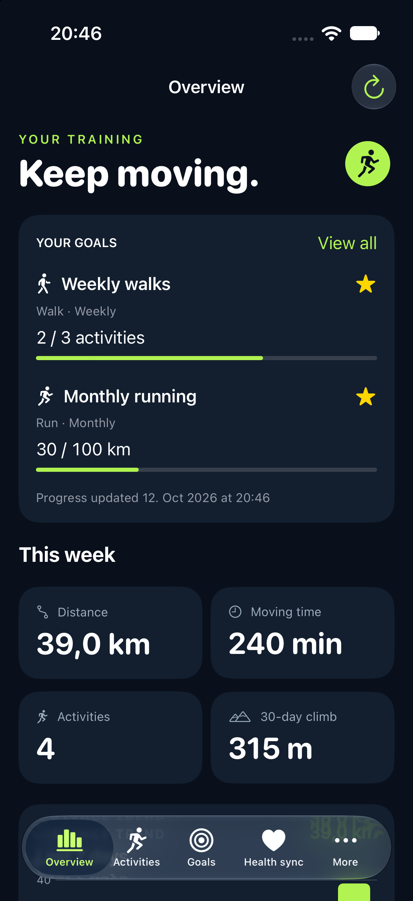 | 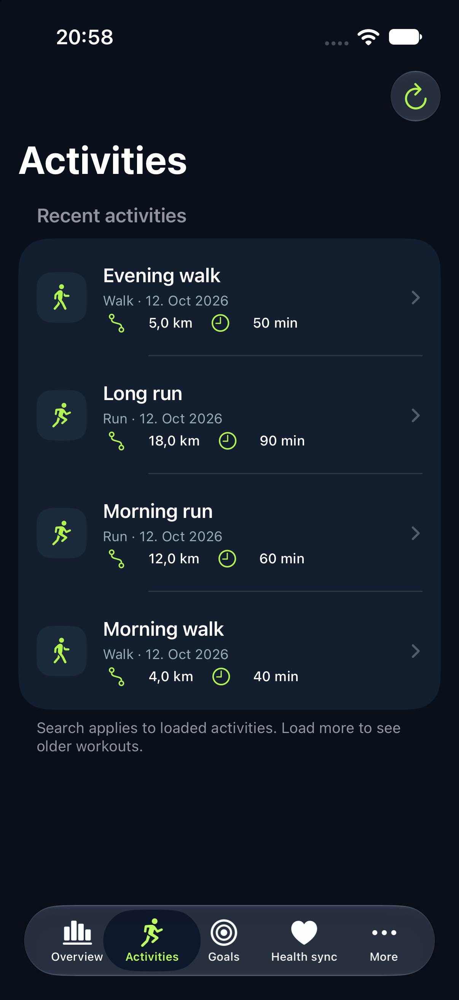 |

| Goals | Create a goal |
| --- | --- |
| 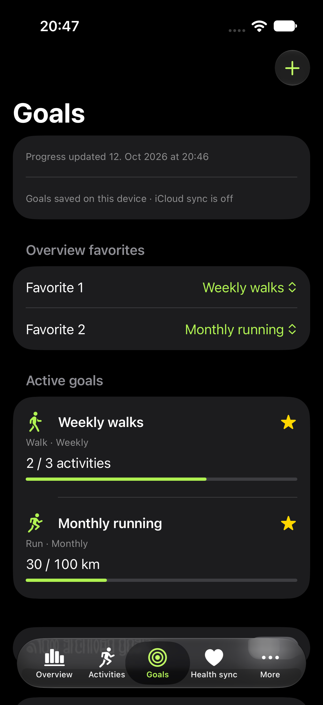 | 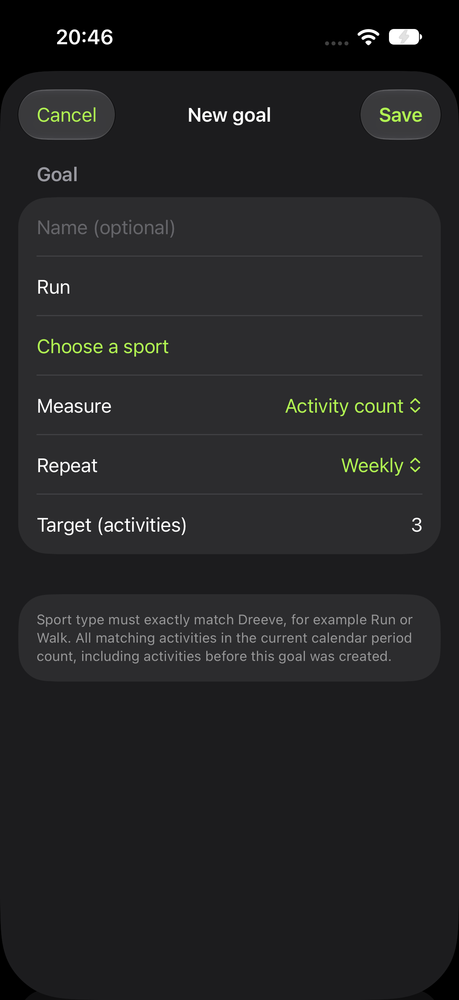 |

| Gear | Activities for a gear | Gear thumbnail in activity details |
| --- | --- | --- |
| 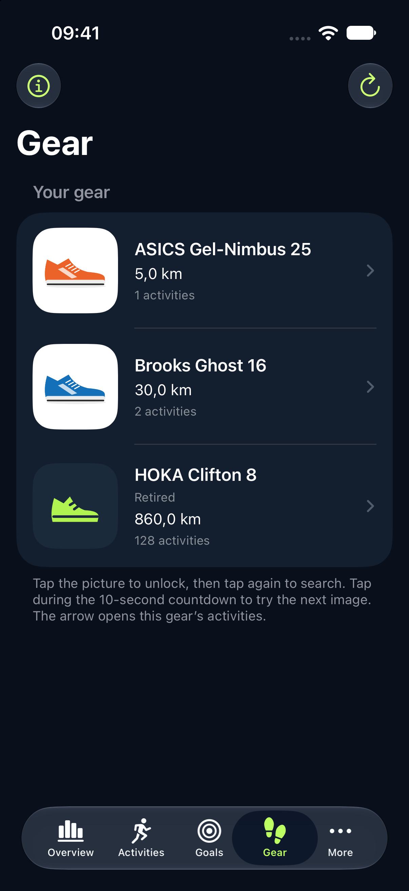 | 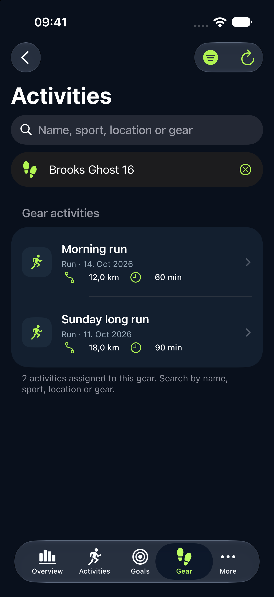 | 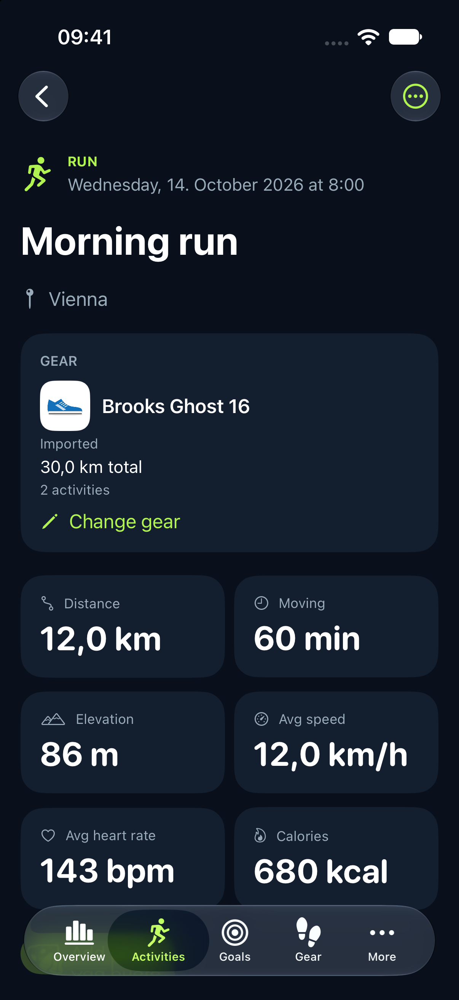 |

| Small widget: in progress | Small widget: goal reached |
| --- | --- |
| 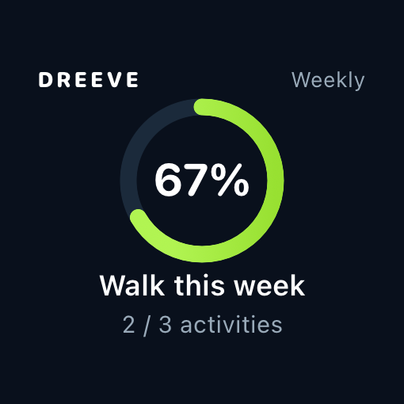 | 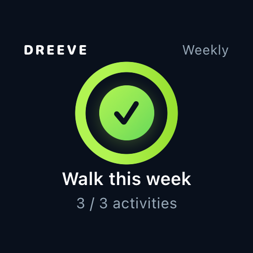 |

| Medium widget: two goals | Large widget: four goals |
| --- | --- |
| 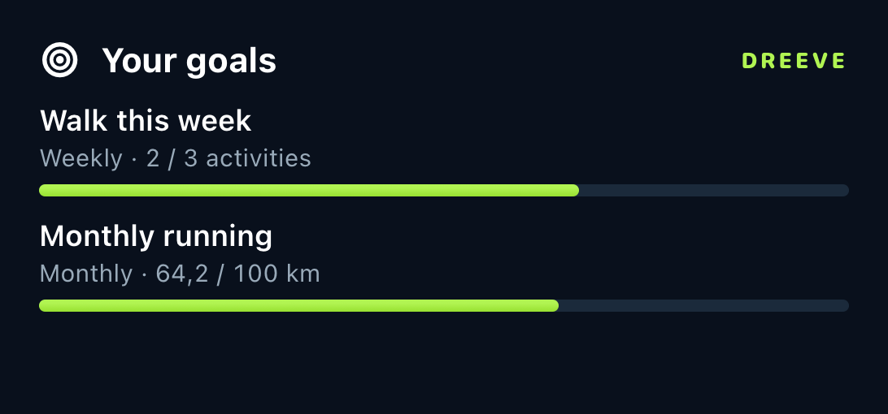 | 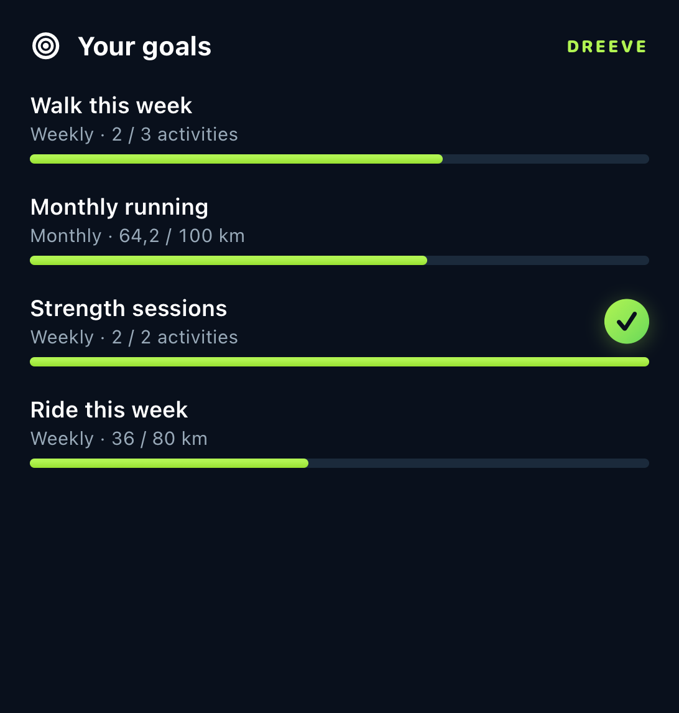 |

## Features included

- Native dark-themed SwiftUI tab navigation: Overview, Activities, Goals, Gear, Health sync, Upload, Settings.
- Connect to a self-hosted Dreeve URL, validate `GET /api/v1/status`, save API token in iOS Keychain (not in source or UserDefaults).
- Browse activities with pagination and local search, see metrics and GPS routes with MapKit.
- Edit name, description, sport type, and assigned gear; delete an activity with confirmation.
- Browse active and retired gear with cached pictures and open each gear's activity list. Display the assigned gear thumbnail, name, imported/custom type, retirement status, lifetime distance, and activity count. Choose existing gear (including retired items) or remove the assignment. Loading errors offer a retry, and missing inventory entries preserve the current assignment.
- Add an image from the Photos library (when upload mode is supported).
- Download an existing GPX and share it from the device.
- Import `.fit`, `.tcx` and `.gpx` from Files using multipart upload, and view import job states. Import is asynchronous.
- Last-30-day dashboard and current-period goals derived from a shared local activity index, with last-7-day chart and sport breakdown. Gear filtering works from saved history, including offline.

## Open in Xcode

1. Use macOS with **Xcode 16 or newer** (SwiftUI / iOS 17 APIs).
2. Unzip and open `DreeveIOS.xcodeproj`.
3. Set a unique Bundle Identifier and your Apple development team under Target → Signing & Capabilities.
4. Select a simulator or iPhone and Run. iOS deployment target: **17.0**.
5. Enter the **HTTPS URL of your own Dreeve instance** and an API key generated in Dreeve Settings → Security → API access. The server must be configured with `DREEVE_API_KEY` and its containers recreated.
6. To upload workouts, Dreeve must use `IMPORT_MODE=files`; status reports `canUpload` accordingly.

**Privacy and networking:** The app requires HTTPS and does not configure insecure App Transport Security exceptions. It does not publish or expose your home server by itself. A VPN/tailnet and privately reachable HTTPS DNS name are suitable. The token is persisted with `kSecAttrAccessibleAfterFirstUnlockThisDeviceOnly`. For stronger protections you may change this to `kSecAttrAccessibleWhenUnlockedThisDeviceOnly`. The URL is stored in UserDefaults, not a secret. Apple Maps tiles use Apple infrastructure.

## API coverage

| App action | Endpoint |
| --- | --- |
| Validate connection | `GET /api/v1/status` |
| List activities / dashboard queries | `GET /api/v1/activities` |
| Detail / GPS route | `GET /api/v1/activities/{activityId}` |
| Edit name/type/notes/gear | `PATCH /api/v1/activities/{activityId}` |
| Gear inventory | `GET /api/v1/gear` |
| Delete activity | `DELETE /api/v1/activities/{activityId}` |
| GPX export | `GET /api/v1/activities/{activityId}/gpx` |
| Add photo | `POST /api/v1/activities/{activityId}/images` |
| Upload FIT/TCX/GPX | `POST /api/v1/activity/upload` |
| Import history | `GET /api/v1/file-imports` |

### Important API boundaries

- There is **no documented manual JSON activity creation endpoint**. “Post” means upload an existing FIT / TCX / GPX file. Live GPS activity recording or HealthKit sync need client development and/or suitable import support.
- There is **no documented insights endpoint** in the reviewed HTTP API. Dashboard analytics are computed client-side from the previous 30 days. The list endpoint supports 100 items/page, so the dashboard requests each page in the period. This may be slow for large instances.
- No built-in social feed, follow relationships, kudos, or account-based login in the documented API. An API key gives server-level access and must **not** be hardcoded in a publicly distributed app. For multi-user App Store distribution, add per-user authentication and authorization server-side.
- Activity summaries are cached locally for Gear, Overview and Goals. Full activity details/photos still require server access, and the main Activities tab retains its paginated network listing. No closed-app activity sync or activity push notifications. Apple Health sync runs manually in the foreground.
- Activity photos use the configured HTTPS Dreeve address for local `/files/activities/` links, including deployments under a subpath. External HTTPS image links keep their original host. Tap a loaded photo to open it full screen, pinch to zoom, drag to pan, or double tap to toggle zoom; swipe down when zoomed out or use the close button to return to the activity. Failed loads show an explanation, Retry, and Open in browser instead of an endless spinner. Website-protected photos still require website access: the v1 API token does not sign in to Dreeve’s separate website session.
- The updated project builds for the generic iOS Simulator destination in Xcode. Interactive simulator operation and a live authenticated Dreeve integration test remain unverified.

## On-device training coach

Overview shows a **Training brief** below favorite goals. It uses the complete local activity index: recorded distance/moving time in the last 7 days, a rolling 28-day weekly average, consistency, the latest activity, and remaining amounts for up to two favorite goals. No extra Dreeve endpoint, paid API key, server AI container or additional entitlement is required. It continues to work offline with saved activities and labels stale data; it waits for the first complete sync before presenting totals.

All figures are calculated in Swift. The duration ratio is last-7-day moving time divided by one quarter of last-28-day moving time, including the recent week. It describes recorded volume across all sports; it does not measure intensity, predict injury or establish an optimal training range. Sparse histories show a baseline label. [Research on limitations of workload ratios](https://pubmed.ncbi.nlm.nih.gov/32502973/).

Latest-workout benchmarks use prior sessions from the last 30 calendar days, excluding the latest activity, with the exact sport type and matching recorded route/virtual category. Virtual and outdoor sessions are not compared. Unknown settings and fewer than two measurable prior sessions omit the benchmark. Pace/speed comparisons describe the records without claiming fitness improvement or adjusting for terrain, weather or effort. Goal totals still combine virtual sports with their equivalents through the existing GoalEngine. Weekly goals use Monday boundaries; days remaining include today, and monthly pacing uses the actual month length. Completed goals need no additional amount; unavailable progress is never treated as zero.

On Apple Intelligence devices with iOS 26+, FoundationModels checks model availability and uses a guided enum schema to choose the emphasis/order of three verified insight categories. Displayed sentences, numbers, workload labels and goal pacing remain Swift-controlled, so generated prose cannot invent facts. Only aggregate figures enter the model prompt; activity/goal names, routes, coordinates, instance addresses and credentials are excluded. Model refusals, failures or a 12-second cancellation timeout fall back to the local rule engine. Older iOS versions, unsupported devices, disabled/not-ready Apple Intelligence and simulator CI all retain the deterministic brief. [Apple Foundation Models availability and generation](https://developer.apple.com/documentation/foundationmodels/generating-content-and-performing-tasks-with-foundation-models).

Briefs are stored in the app's local Caches directory, excluded from backup, with hashed per-instance filenames and atomic writes. The fingerprint includes the reference day, activity fields and favorite goal state, so imports, edits, deletions, goal changes and period rollovers invalidate it. Cached output is reused across launches; model availability changes are checked on foreground entry. Use the card's refresh button to force regeneration, including after a model failure. Coach output is not synced through CloudKit or sent to an external service.

Implementation: `CoachContextBuilder.swift`, `CoachEngine.swift` and `CoachCardView.swift`. `CoachContractTest.swift` runs with `./run_tests.sh`; the CLI tests explicitly disable model use for deterministic, offline CI.

Validation: the full regression suite, coach contract tests, simulator Debug build and unsigned iPhone Release build pass. An isolated simulator run with synthetic activity/goal data exercised the actual FoundationModels curation path and verified the card layout. Physical-iPhone availability, latency and foreground/offline interaction remain device checks.

## Activity share cards

Open an activity and tap **Share activity card**. Choose a transparent sticker, dark map poster, or photo background, then select Story (1080 × 1920) or Square (1080 × 1080). The live preview includes the route, activity date/title, distance, sport-appropriate pace or speed, duration and assigned gear with its cached thumbnail.

**Copy sticker / Copy PNG** preserves the PNG image, including transparency for stickers. **Share image** opens the native share sheet with a PNG file. Photo backgrounds are chosen with the system photo picker; when a foreground subject can be detected, the route can be placed behind it. Subject detection happens on device. Photos and generated cards are not uploaded to Dreeve or stored in CloudKit. Temporary sharing files are removed when the share sheet closes.

Dark maps use Apple's native snapshot service and retain its attribution. If the map is unavailable, the card falls back to a route-only background. Indoor activities and missing or malformed routes still produce telemetry cards. The activity's local date is preserved without a timezone conversion.

Implementation: `RouteGeometryProjector.swift`, `ShareCardRenderer.swift` and `ShareCardSheetView.swift`. The standalone `ShareCardContractTest.swift` suite covers polyline decoding, malformed input, date-line crossings, Mercator aspect ratio, degenerate routes, telemetry and export dimensions, and runs with `./run_tests.sh`.

Validation: full standalone regression suite, simulator Debug build and unsigned iPhone Release build pass. Simulator checks verified Story/Square PNG dimensions, transparent sticker corners, native dark-map output with visible attribution, synthetic subject/route compositing and the customization screen. Real-photo subject detection and receiving apps’ copy/share behavior still need an iPhone check.

## Code map

- `DreeveApp.swift`: launch and navigation
- `APIClient.swift`: bearer-auth HTTP client and uploads
- `Session.swift`: observable application state
- `Models.swift`: API DTOs and local activity insights
- `KeychainStore.swift`: secure token storage
- `DashboardView.swift`: summary and trends
- `ActivitiesView.swift`: paginated list
- `ActivityDetailView.swift`: detail, edit, photos, GPX, delete
- `RouteMapView.swift`: encoded polyline map
- `UploadView.swift`: file picker, upload queue/history
- `SettingsView.swift`: server URL, API key, server capabilities

Reference OpenAPI: https://docs.dreeve.app/api/openapi.yaml

## Gear API contract (checked October 12, 2026)

- Inventory: `GET /api/v1/gear` returns `{ "gear": [...] }`. The app joins an activity's nullable `gearId` to this inventory. `type` means `imported` or `custom`, not shoe/bike category. The documented example omits `isRetired`, so decoding tolerates missing metadata.
- Assignment: `PATCH /api/v1/activities/{activityId}` with `gearId` set to the complete prefixed identifier (for example `gear-b12659861`).
- Removal: explicitly send `"gearId": null`. Swift's default optional encoding would omit the key; the custom `ActivityPatch` encoder distinguishes omission, assignment, and removal.
- Unchanged: omit `gearId` when saving other fields. An unknown current ID is retained rather than silently cleared when inventory loading fails or the gear no longer appears.
- Save success: use the returned activity immediately in detail, activity list, and insights state; refresh the detail gear inventory to update totals. Failed saves stay in the editor and show the server explanation.
- Updates require `IMPORT_MODE=files`. Details refresh server capabilities before enabling editing. Other import modes keep gear visible but disable changes; the server's 409 explanation is also surfaced if mode changes during an edit.

Sources: [List gear](https://docs.dreeve.app/api/operations/listgear/) and [Update activity](https://docs.dreeve.app/api/operations/updateactivity/).

## Verification

Completed for this update:

- Full Debug build with Xcode for the generic iOS Simulator destination, code signing disabled: **passed** (arm64 and x86_64).
- Standalone gear contract tests using URLProtocol mocks: **passed**. Cover inventory metadata, empty inventory, omitted retirement metadata, nullable activity gear, assignment/removal/unchanged encoding, preserving missing current gear, authenticated GET/PATCH paths (including deployment subpath), response decoding, and 400/401/409 server errors.
- Original model smoke test: **passed**.
- Xcode project syntax validation and ZIP integrity: **passed**.

Run the portable tests on macOS with Xcode installed:

```sh
./run_tests.sh
```

Test sources are standalone executables rather than an Xcode XCTest target. Run a simulator build from the project folder with:

```sh
xcodebuild -project DreeveIOS.xcodeproj -scheme DreeveIOS \
  -sdk iphonesimulator -destination 'generic/platform=iOS Simulator' \
  -derivedDataPath /tmp/dreeve-build CODE_SIGNING_ALLOWED=NO build
```

Live instance checks still needed: open an activity with assigned gear, select another item and save, reopen the activity to confirm persistence, then choose No gear and confirm removal. Check an activity with no gear, a retired item, and an empty inventory. In Strava import mode, verify gear remains visible and editing is disabled. Test server/network errors and retry. No real server records were modified during this update.

## Application icons

The configured `AppIcon` asset uses the official Dreeve mark with its orange color preserved, a navy (`#09101c`) background, and navy negative space. This dark design is the default on iOS 17 and later and is also explicitly registered for the iOS dark appearance. The icon is opaque and square; iOS supplies corner masking. Xcode derives device icon sizes from the 1024 × 1024 source.

`Branding/` contains the unchanged official SVG plus editable SVG and opaque PNG versions for both white and navy backgrounds. The white version is available as an alternative; the navy version is assigned to the app. Source: [official Dreeve logo](https://raw.githubusercontent.com/dreeveapp/dreeve/master/public/assets/images/logo.svg).

## Manual Apple Health synchronization

Use the **Health sync** tab, choose a starting date, choose whether to include routes and heart rate, and tap **Load Apple Health workouts**. Grant read access through Apple's permission sheet. Select individual workouts, then tap **Sync selected** in the fixed bottom action bar and confirm the destination server. The button remains visible while you scroll through workouts. The app requests no HealthKit write permission and does not modify or delete your original Health records.

Each chosen workout becomes an in-memory **FIT activity file**, exported directly from the original HealthKit workout rather than converted from GPX. Workouts without GPS also export. FIT session/lap summaries preserve Health's known distance, calories, elapsed time and active duration separately. Enabled routes retain coordinates in FIT semicircles (approximately 0.000000084° resolution), altitude and valid recorded speed; enabled heart-rate samples and available pause/resume events are included. New running/cycling exports also include available power; cycling exports include measured cadence, and running/walking/hiking cadence is derived from recorded step-count intervals. Cadence and power are included in FIT record streams and lap/session average/max fields. Existing imported activities are not edited or backfilled. Missing measurements are marked invalid, not fabricated. Standard FIT records have one-second timestamps; samples within a second are merged chronologically with the latest measured value per field. Indoor workouts use start/end records without invented GPS or sensor readings.

Health read authorization includes step counts, running power, cycling power and cycling cadence. Grant access to these additional types when prompted; missing or denied readings remain absent. Quantity-series queries unpack condensed Health samples rather than using only the parent sample average. Workout-associated readings are preferred, with a time-bounded fallback restricted to the workout's recording source. This avoids adding phone and Watch step counts together.

Running/walking/hiking cadence is an interval-average estimate: recorded steps divided by their sample duration, converted to FIT cycles/min (half the steps/min). Cycling cadence stays in revolutions/min and power is exported in watts. Fractional cadence uses FIT's standard 1/128-rpm field. Sensor intervals are resampled into covered one-second buckets, clipping to the workout and excluding known pauses; duplicate/overlapping intervals are not added together, uncovered gaps stay missing, and recorded zero power remains zero. Average/max summaries use the exported covered seconds. Availability depends on the recording device/source and Health permissions; no power is estimated from pace and no cadence is invented from GPS.

Recording source names are preserved as device names. FIT sport/sub-sport and profile names describe the original mapped sport; the post-import PATCH reconciliation remains for older TCX imports and server mapping differences. Refresh status to finish linking imported activities. Imported or manually linked activities show their Apple Health source and original duration in activity details.

**Duplicates and recovery:** Filenames contain the original HealthKit workout UUID and now end in `.fit`. Existing imported workouts are not uploaded again just because the format changed. Both `.fit` and legacy `.tcx` filenames are checked across every import-history page before a new upload; exact filename matches are required. Older journal records retain their TCX filename for queued/unconfirmed import reconciliation, and new records persist the actual FIT filename. A device-local journal, scoped to the server URL, records upload intent before sending. Queued and unconfirmed requests are not blindly repeated after restart. The app checks server history by exact filename and reviews existing activities near the original start time. Possible matches require explicit confirmation; selecting **Link this activity** creates a local association with no upload. If these are different workouts, explicitly allow a new upload. This is a heuristic check, not a global uniqueness guarantee: old exports may have different times/time zones, and different HealthKit records may describe the same workout. For unconfirmed network outcomes, refresh first; an explicit retry remains available with a duplicate warning. Failed imports can be selected again. Server-reported duplicate skips are shown separately from imported workouts.

The journal contains HealthKit IDs, workout summaries, destination URLs, and activity links, never API tokens or raw GPS/heart-rate samples. It is stored in Application Support, excluded from backups, and protected with complete file protection on iOS. If the journal cannot be read or saved, uploads stop rather than lose duplicate tracking. Links are local to this installation; Dreeve has no HealthKit-ID field in its current public API. Deleting an activity in Dreeve does not delete it from Health or automatically upload it again. When Health workouts are loaded or status is refreshed, linked imported activities are checked directly. A confirmed HTTP 404 changes the local status to **Deleted from Dreeve — select to re-import**, clears the obsolete activity link, and allows an explicit FIT upload. Opening Health sync with previously loaded workouts also refreshes status. Retained successful import-history rows are ignored only when their linked activity returns 404; queued/unconfirmed imports, missing activity IDs, authorization errors and network failures are not treated as deletion. Refresh also updates nearby-workout candidates so a deleted activity does not remain a stale duplicate suggestion.

**Current limits:** Synchronization is one way (Health → Dreeve), manual, and runs while the app is open. A 202 response means queued, not imported. The server needs `IMPORT_MODE=files` and its normal file-processing job. Refresh status after that job runs. No automatic background delivery, propagation of later workout edits/deletions, or lap splits are implemented. FIT preserves active versus elapsed duration, but speed/elevation metrics may still differ from Apple's algorithms. FIT cannot repair inaccurate GPS measurements or recover missing information from an existing GPX file. Apple's HealthKit read privacy means an empty result can mean no workouts, limited history, or denied permission. Existing FIT/TCX/GPX Files uploads and the server's GPX download endpoint remain available.

**Verification for this update:** Simulator and unsigned iPhone builds passed. Portable contract tests cover cadence/power record and summary fields, fractional cadence, step-rate conversion, interval weighting, duplicate/gap/zero/pause handling, FIT header/file CRCs, required activity/lap/session messages, indoor output, GPS precision and antimeridian bounds, altitude/speed/heart-rate values, pause events, separate elapsed/active totals, sport mappings, timezone-aware local timestamps, legacy TCX journal decoding/reconciliation, multi-page exact-filename checks, durable history, confirmed deletion recovery, retained import history, pending/offline protection, duplicate candidates and authenticated binary multipart uploads returning 202. Synthetic indoor/outdoor and cadence/power files were independently decoded and checked with Garmin's official Swift SDK. No SDK/runtime dependency is added to the app; the writer implements the public FIT protocol directly. These are synthetic/mock checks; no real Health data was read and no live Dreeve records were modified.

**Real-device checks required:** Enable HealthKit for your signing team's App ID/provisioning profile. Build and run on an iPhone with readable workouts, grant permission, sync a single indoor workout and a single outdoor workout, let Dreeve process them, refresh status, and inspect the summary, route, heart rate, cadence, power, sport, and local link. Repeat refresh/relaunch to confirm no second upload. Confirm or reject a match from the old importer, test optional data permissions, and test denied Health access and a server/network error. Successful compilation does not verify device HealthKit permissions or live import processing.

Implementation: `AppleHealthReader.swift` (read-only HealthKit queries), `HealthFITExporter.swift` (FIT encoding), `HealthSyncCore.swift` (journal, import history and matching), `HealthSyncStore.swift` (uploads/reconciliation), and `HealthSyncView.swift` (manual selection and review). Tests: `DreeveIOSTests/HealthSyncContractTest.swift`, included in `./run_tests.sh`.

References: [Garmin FIT protocol](https://developer.garmin.com/fit/protocol/), [Dreeve FIT parser](https://github.com/dreeveapp/dreeve/blob/master/src/Domain/Import/FileParser/FitFileParser.php), [Apple HealthKit authorization](https://developer.apple.com/documentation/healthkit/authorizing-access-to-health-data), [Dreeve file upload](https://docs.dreeve.app/api/operations/uploadactivityfile/), and [file import status](https://docs.dreeve.app/api/operations/listfileimports/).


## Weekly and monthly Goals (October 12, 2026)

Create any number of independent recurring goals in the Goals tab. Each goal chooses an exact Dreeve sport type, activity count or distance, weekly or monthly frequency, and a positive target. Counts must be whole numbers. Distance is entered/displayed in kilometres and stored in metres. Tap a goal to edit it, swipe left to archive, or restore archived goals. Delete is available in the editor. Select Favorite 1 and Favorite 2 at the top of Goals; Overview shows only those selected slots. Concurrent favorite-slot conflicts are resolved deterministically in the UI.

### Local goals and widget signing

Default Debug/Release builds keep SwiftData goals local, with iCloud and Push Notifications disabled. The Home Screen widgets add the **App Groups** capability to share derived goal progress with the extension. On a device, both app and extension need a signing team/profiles that support that App Group. The earlier Personal Team-only setup cannot provide this shared-container widget feature. See the widget setup below. Unsigned simulator/iPhone builds remain available for CI; they do not establish that a device provisioning profile is eligible.

Apple limits capabilities by program membership. See [supported iOS capabilities](https://developer.apple.com/help/account/reference/supported-capabilities-ios) and [configuring App Groups](https://developer.apple.com/documentation/xcode/configuring-app-groups).

### Optional iCloud sync with an eligible paid team

1. Select an Apple Developer Program team and a unique bundle ID.
2. In the target's Build Settings, set **Code Signing Entitlements** (`CODE_SIGN_ENTITLEMENTS`) to `DreeveIOS/DreeveIOS-iCloud.entitlements` and **Info.plist File** (`INFOPLIST_FILE`) to `DreeveIOS/Info-iCloud.plist` for both Debug and Release. The default local files keep iCloud disabled; their widget App Group still requires eligible signing.
3. In Signing & Capabilities, enable **iCloud → CloudKit**, **Push Notifications**, and **Background Modes → Remote notifications**. Create/select `iCloud.<your bundle ID>` in your developer account. If using another container, update the identifier in both optional iCloud files. These capabilities synchronize goal definitions; Dreeve activity progress still requires API refresh.
4. Run signed builds on two devices using the same iCloud account and container. Verify goal creation/edit/archive and favorites on both. Sync is asynchronous; Goals displays account/sync status.
5. Before TestFlight/App Store distribution, initialize the development CloudKit schema with a signed development run and deploy it to production in CloudKit Console. Keep the bundle/container identity stable.

To return to local mode, restore the two default build-setting paths and remove the iCloud, Push Notifications and remote-notification Background Mode capabilities. Both modes use the same on-device goal database; changing mode does not clear goals.

The simulator uses local SwiftData storage by default, because unsigned simulator builds can crash inside CloudKit when no entitlement is present. To test iCloud on a **properly signed and entitled simulator**, add `DREEVE_SIMULATOR_CLOUDKIT` to Swift Active Compilation Conditions. Do not add it to an unsigned build. Local device storage is already the default. Enabling the optional cloud files requires eligible signing even on a simulator. A recoverable container-opening failure attempts the same on-disk store without CloudKit; it never silently substitutes an empty memory database.

Only goal definitions, archive state and favorite ranks enter the private CloudKit database. Instance scope is a SHA-256 hash of the normalized HTTPS deployment URL (host casing/default HTTPS port/trailing slashes normalized; subpaths preserved). The URL itself and API credentials are not stored in goal records. Tokens remain in Keychain. Reconnecting to the same deployment restores its goals; another deployment has a separate set. Dreeve's documented API key is instance-level, so this is deployment scoping, not user-account scoping.

### Progress and calendar rules

- Goals combine matching real and virtual sports: `Run` + `VirtualRun`, `Ride` + `VirtualRide`, and `Rowing` + `VirtualRow`, for activity count and distance. For example, a 6 km outdoor run and a 5 km virtual run contribute 11 km and two activities. Existing goals using either name share the combined total; other sport types remain distinct.
- Creation time is metadata, never an activity cutoff. A Thursday goal includes Monday–Thursday activity; editing sport/metric/frequency/target immediately recomputes against the whole current period.
- Gregorian weeks run Monday 00:00 through the next Monday exclusively; months run from day 1 to the next month's day 1 exclusively. The device's current timezone determines **today** and therefore the active week/month. Activity membership uses the date portion of `startDateLocal`, preserving its recorded wall-clock date without converting timezone suffixes. Date arithmetic uses floating calendar components to avoid daylight-saving shifts.
- The [activity search API](https://docs.dreeve.app/api/operations/listactivities/) documents inclusive `filters[from]`/`filters[to]` date filters, page numbers starting at 1, maximum page size 100, and `pagination.totalPages`. It does not explicitly specify the filter timezone. The app fetches all history once, then uses a buffered delta window. Exact goal/dashboard membership always uses the recorded local date. Delta pruning retains its oldest boundary day because the server filter timezone is unspecified.
- Gear, Overview and Goals share a SwiftData activity index. The first sync reads every page (100/page), retaining successfully downloaded pages if interrupted. Goals/Overview only adopt complete histories; subsequent delta batches are atomic. Duplicate activity IDs are suppressed, malformed or changing pagination is rejected, and local edits/deletions invalidate older in-flight responses. Full scans prune remotely deleted activities only after every page succeeds. Dreeve has no snapshot API, so simultaneous server changes may require another refresh.
- Current-period values are computed on device. Distance sums nonnegative distances, and each matching activity counts once. One activity can contribute independently to several goals. Over-target values remain visible.
- Refresh on app open/foreground, every 60 seconds while active, after edits/deletions/uploads, when import status is read, and with pull-to-refresh or Overview's refresh button. Upload acceptance is not completion: active polling picks up the eventual imported activity. In-flight results cannot overwrite local activity changes or cross instance switches.
- Activity summaries and per-instance sync cursors persist in a dedicated Application Support SQLite store with CloudKit disabled and backup exclusion on its directory (including SQLite sidecars). Existing goal-definition storage is unchanged. A lightweight derived goal snapshot remains in Caches for compatibility/widgets. Failed refreshes retain saved values and show stale/error status; incomplete histories are labelled. Values become stale after five minutes or a period change.
- There is no Dreeve activity push integration or closed-app activity refresh. Foreground refresh reconciles imports/edits/deletions made elsewhere. Historical goal achievements are outside this version's scope.

### Goal verification

- Xcode 27 Debug simulator build: passed for arm64 and x86_64; unsigned simulator startup checked. Generic iPhone arm64 build also passed with signing disabled.
- Standalone regression tests: original model and gear tests passed. New tests cover Monday/month/year boundaries, leap years, DST and travel, local timestamp suffixes, invalid dates, retroactive counting/distance, edits/deletions, duplicate IDs, all-page queries and later-page failures, 121 persistent goals, favorite-slot conflicts, archive exclusion, instance normalization/isolation, local offline snapshots, in-flight mutation/switch races, and cancelled foreground callers with a resumed refresh.
- SwiftUI Overview, Goals list and goal editor rendered on an iPhone simulator using an isolated temporary fake-data build. The fixture is not included in the delivered app. An inherited card layout issue was corrected so metric labels and values stay together.
- Live authenticated Dreeve operations and signed two-device CloudKit synchronization remain unverified; no real server records were changed. Follow the iCloud setup steps and verify a real activity edit/delete/import before relying on the app.

New sources: `GoalEngine.swift` (calendar, scope, calculations), `GoalStore.swift` (SwiftData/CloudKit and local progress cache), `GoalsView.swift` (list/editor/favorites/status), `DreeveIOS.entitlements`, `Info.plist`. Goal tests run with `./run_tests.sh` on macOS 14+ and Xcode. They are standalone executables, not an XCTest target.

Apple reference: [Syncing model data across a person's devices](https://developer.apple.com/documentation/swiftdata/syncing-model-data-across-a-persons-devices).

The Goals feature was merged into the canonical repository with Apple Health sync, its HealthKit entitlement, API helpers and app icons preserved. Health import reconciliation also triggers goal refresh. On iPhone, the additional tab may place some screens in the system More menu.

## GitHub Actions: builds and releases

`Build and test` runs on pull requests, pushes to `main`, and manually from Actions. It runs all standalone model/gear/Health/Goals tests, builds the shared `DreeveIOS` scheme for iPhone and Simulator, and uploads downloadable packages plus test/build logs. It uses GitHub's `macos-26` runner and its default Xcode; toolchain versions are recorded in the log. Builds are unsigned and use the existing local-goal configuration, with no Apple signing secrets required.

`Release` runs when a version tag is pushed, for example:

```sh
git tag v1.0.0
git push origin v1.0.0
```

Commit and push the workflow files first. Tags must have the form `v1.2.3` or `v1.2.3-beta.1`. The release workflow calls the same verified build in Release configuration, sets the app version from the tag and build number from the workflow run, then publishes a GitHub release after checking package checksums. Prerelease tags produce prereleases. Existing releases are not overwritten; re-running a publish job for an already published tag will fail rather than replacing its assets.

Release assets:

- `DreeveIOS-project.zip`: tracked Xcode project/source at the exact tagged commit, ready to open and sign in Xcode.
- `DreeveIOS-simulator.zip`: compiled `.app` for the runner's iOS Simulator SDK/architecture; install in a compatible simulator using `xcrun simctl install booted DreeveIOS.app`.
- `DreeveIOS-unsigned.ipa`: compiled iPhone Release app in a Payload ZIP. It requires your own signing/provisioning before installation. It cannot be installed directly and is not a TestFlight/App Store distribution.
- `SHA256SUMS.txt`: checksums for the three packages.

Only the publish job has `contents: write`; pull-request and build jobs have read-only access. Official GitHub Actions are pinned to verified commit IDs. The repository must allow GitHub Actions and the workflow's release job token to write releases. No API keys, Apple certificates, personal provisioning profiles or iCloud credentials are included.

To reproduce a build locally, run `bash scripts/ci_build.sh Debug /tmp/dreeve-ci` (or `Release`). This runs tests and both builds, records logs, and packages the currently committed source. GitHub execution has to be verified after these files are pushed; local validation cannot establish the hosted runner's result.

## Local activity index and delta sync

`ActivityIndexStore.swift` owns a separate local SwiftData schema (`IndexedActivity`, `InstanceSyncCursor`) with `cloudKitDatabase: .none`. It never joins the Goals CloudKit container or widget extension. Records are scoped by the existing normalized instance hash, and do not contain API credentials. Summary payloads retain location and metrics needed by existing rows; full detail still loads through the API.

After a successful full backfill, normal foreground refreshes use `filters[from]` set to the newest indexed local day minus 14 days, and exhaust every page returned. Recent deletions are reconciled within that window after the entire delta succeeds; its oldest boundary day is retained for timezone safety. Older server-side edits/deletions and backdated external imports outside this window are discovered by a full reconciliation at least every seven days while the app is opened, or immediately by manual refresh in Gear/Overview/Goals. A full reconciliation is also requested when a tracked app import completes, including older workouts. This API offers a date-based delta, not a server change-token feed.

Opening multiple screens coalesces concurrent syncs; completed refreshes are reused for 15 seconds to prevent redundant requests. The existing 60-second foreground loop now refreshes the shared index, which feeds both Overview and Goals. Local PATCH/DELETE writes update the index immediately, so gear moves/removals and totals are reflected without another history scan. Cancelling a view task does not cancel its owned sync. Connection generations prevent old requests from publishing into another connection.

Standalone tests cover cold backfill/retry, 14-day requests, local-date/DST validation, all-page and malformed pagination, atomic delta failure, delayed pruning, concurrent callers and local mutation races, instance isolation, SQLite relaunch/backup exclusion, actual API query parameters, shared dashboard/goal refreshes, offline gear queries, and write-through PATCH/DELETE. Device and live-server performance still need verification; no fixed millisecond latency is guaranteed.

## Gear screen and pictures

The Gear screen lists active and retired gear, distance and activity counts. Each row starts with a running-shoe symbol in a rounded tile. The arrow opens an Activities screen filtered by that gear; Activities also has a gear-filter menu and text search matches loaded gear names.

Dreeve's website supports gear filtering, but the current public v1 API only exposes date/sport/GPX filters. Gear activity lists now query the local activity index by full `gearId`, without scanning the server each time a gear row opens. The initial index backfill includes all history, so older workouts are included. Saved results appear before sync and remain available offline; incomplete and stale results are labelled. Pull-to-refresh or the refresh button on a gear-filtered list forces a full reconciliation. See [the public filter implementation](https://github.com/dreeveapp/dreeve/blob/master/src/Domain/Activity/Search/ActivitySearchFilters.php).

To choose a picture:

1. Tap the tile once to show the unlock symbol.
2. Tap again to search SearXNG for the gear name plus `running shoe product photo` using `categories=images&format=json`. A loading indicator covers the tile while searching/downloading.
3. The first usable HTTPS image is displayed. During the visible 10-second countdown, tap again to try the next result from that same search. Each displayed replacement gets a new 10-second countdown.
4. Leave the picture for 10 seconds to accept it. A later session requires unlock, then a second tap starts a fresh search from the first result.

No search endpoint is preconfigured. Enter your own HTTPS SearXNG search URL under Settings → Gear image search (for example, `https://search.example.com/search`). The instance must permit JSON search responses (`search.formats` includes `json`). The URL is stored only in local app preferences.

Image selection keeps SearXNG's result order, tries a result's HTTPS thumbnail if the original cannot load, and skips unsupported/broken images. When results run out or a request fails, the current picture is retained with an explanation. Network requests use a separate ephemeral session, no Dreeve bearer token, no cookie storage and no URL cache. Search responses are limited to 4 MB and image downloads to 12 MB; supported images are downsampled to a centered 512×512 PNG with aspect-fit padding. Uniform light product-photo margins are trimmed when possible; complex photo backgrounds keep the full image.

Pictures are stored in Application Support, separately from SwiftData/CloudKit and excluded from iCloud backup. The filename hashes both the Dreeve instance and gear ID. There is exactly one cached image per gear/instance: atomic replacement removes the previous file contents only after a new image is ready. Existing pictures load locally without another search. The last displayed picture is retained if you close the app during selection. A brief navigation away keeps the countdown; pending downloads are cancelled when leaving the screen or backgrounding the app.

Verification includes portable tests for the two-tap state machine, 10-second expiry/restart, ordered SearXNG decoding, request query/auth isolation, errors and size limits, cache replacement/relaunch/instance isolation, and full-history gear filtering with duplicate/stale IDs. Simulator checks verify subject centering and the actual image-download/cache/countdown flow. The portable tests run through `run_tests.sh` and therefore also run in GitHub Actions. Simulator-specific image-processing checks were run separately in an isolated temporary QA app; fixture data is not shipped.


## Home Screen goal widgets

Add **Dreeve → Goal ring** (small) for circular progress, or **Goals overview** (medium/large) for progress bars. Reaching or exceeding the target shows a navy check in a lime-to-green badge that matches the app. Tap a widget to open Overview.

See the [screenshot gallery](#screenshots) for small progress/completion rings and medium/large progress-bar layouts.

The small widget supports **Edit Widget → Goal** to choose any active goal. Its initial choice prioritizes your first favorite. The medium widget shows two goals and the large widget shows up to four, with your selected favorites first. Archived/deleted goals are excluded. If a specifically selected goal becomes unavailable or belongs to another Dreeve connection, the widget asks you to choose another; it never quietly substitutes a different goal.

### Device setup

1. In the project's Build Settings, set `DREEVE_APP_BUNDLE_IDENTIFIER` to your unique app identifier. The widget bundle ID and default group ID derive from it. Both targets must use the same eligible signing team.
2. Register/enable **App Groups** for both **DreeveIOS** and **DreeveWidgets**, using the same `DREEVE_APP_GROUP_IDENTIFIER` (default `group.<app bundle ID>.goals`). The supplied app/extension entitlements and Info.plist files reference this shared setting. Automatic signing can manage profiles when your account has permission. Personal Teams do not support the shared App Group setup needed here; see [Apple's capability matrix](https://developer.apple.com/help/account/reference/supported-capabilities-ios).
3. Run the app once, connect to Dreeve, create/select goals and refresh progress. Then add a widget from the iOS Home Screen widget gallery. A new install or inaccessible shared container shows an open-app prompt rather than demo progress. CloudKit remains optional and is not required for the widgets.
4. Release signing must cover both the app and embedded `.appex`, with matching app-group membership. CI builds both automatically through the main shared scheme and validates extension embedding, bundle IDs, version/build numbers and group settings before packaging. Unsigned release assets require your own provisioning/signing for both products.

### Refresh and privacy

Widgets show the last goal snapshot published by the app. Goal/favorite edits, archives/deletions, activity progress refreshes/edits/deletions, account switches and logout update or clear that snapshot and request a WidgetKit reload. An unchanged snapshot does not trigger another reload. WidgetKit schedules actual reloads; the extension asks for a refresh around every 15 minutes and includes a local-midnight entry. External server activity changes require an app refresh; the widget does not make authenticated API calls in the background.

A week/month rollover never reuses the previous period's completion check. Until the app fetches the new period, the value is unknown and the widget asks for a refresh. Widgets omit update-time labels. Cached progress remains available after a failed refresh. The widget uses the same Monday-based calendar boundaries and local-day membership calculated by the main goal engine. A local App Group JSON snapshot contains only the current instance hash, active goal definitions, favorite IDs, derived totals, period boundaries and refresh status. It contains no API token, server URL, Health samples or raw activities; it is written atomically with device file protection and excluded from backup. SwiftData and its optional CloudKit database stay in the main app's existing location.

Widget logic tests cover completion/overshoot, period rollover, unknown progress, favorite ordering, unavailable selection, freshness, shared-cache persistence/corruption, instance replacement/logout and credential-free payloads. The app and embedded extension are built for simulator and iPhone. The small, medium, large, completed, empty and rollover views were rendered in an isolated simulator preview app. Real Home Screen registration, App Intent selection, shared-container access and timeline scheduling still need verification with an appropriately signed installation.
